<picture>
  <source media="(prefers-color-scheme: dark)" srcset="assets/header-dark.svg" />
  <source media="(prefers-color-scheme: light)" srcset="assets/header-light.svg" />
  
</picture>

**Desarrollador Web & Móvil | PHP · Flutter · Vue.js · AI Agent Architecture**

> Construyendo soluciones digitales desde 2008. Especializado en sistemas de automatización con agentes IA, protocolos de desarrollo propios y productos reales que resuelven problemas reales.
> **Disponible para posiciones remotas full-time o proyectos de alto impacto en IA.**

  
  
  
  

---

## Sobre mí

Soy Martín, desarrollador de software especializado en sistemas y aplicaciones con inteligencia artificial, Agentes Inteligentes y Automatización. Desde 2008 construyo soluciones digitales a medida bajo **Creawebes Studio**. Retomé con toda la energía en 2023, incorporando agentes IA, automatización y metodologías de desarrollo modernas.

Combino mi formación en diseño gráfico con el desarrollo técnico, lo que me permite tener una visión integral de cada proyecto: desde la arquitectura hasta la experiencia visual del usuario final.

🤖 Construyendo **sistemas de agentes IA con memoria persistente** — protocolos propios de desarrollo, seguridad y deploy que aplican a cualquier proyecto
🔭 Explorando: arquitectura multi-agente, orquestación de LLMs y automatización end-to-end
🚀 Publicaciones en producción en **7 tiendas y registros oficiales**: **VS Code Marketplace · Open VSX · npm · GitHub Marketplace · Google Play · App Store · Amazon Alexa Skills**

## Experiencia Profesional 💼

* **Freelance Developer & AI Architect | Creawebes Studio** *(2008 – Actualidad)*
  * Desarrollo a medida de aplicaciones web, e-commerce y sistemas de automatización con IA para clientes.
  * Diseño e integración de plataformas escalables (PHP, Vue.js, Tailwind CSS).
  * Gestión completa del ciclo de vida del software: arquitectura → desarrollo → deploy → mantenimiento.

* **Desarrollador Móvil Multiplataforma** *(Actualidad)*
  * Desarrollo de apps nativas (Android y iOS) con Dart/Flutter aplicando Clean Architecture.
  * Publicación en Google Play Store y App Store.

## Formación 🎓

* **Máster en Desarrollo con IA** — BIG school + Universidad Isabel I (2026)
  * Doble titulación (certificación profesional + universitaria, 6 ECTS).
  * +200 horas, +80 módulos: Fundamentos, Ingeniería, Arquitectura, IA, Calidad, Seguridad (OWASP), Infraestructura/Cloud.
* **Programador PHP** — Escuela BIOS Uruguay.
* **Diseñador Gráfico** — Escuela Master Barcelona.

## Stack 💻

### Backend
 

### Frontend

 
 

### Testing

### Infraestructura y herramientas

 

### Desarrollo Móvil / Multiplataforma

## Proyectos destacados 🚀

### 🛡️ [ITV de Código — Extensión VS Code Marketplace, MCP App & Gate DevSecOps (7 Estaciones)](https://github.com/20Luisma/itv-calidad)

🧩 **[VS Code Marketplace](https://marketplace.visualstudio.com/items?itemName=20luisma.itv-calidad-vscode)** · 🟣 **[Open VSX](https://open-vsx.org/extension/20luisma/itv-calidad-vscode)** · 📦 **[npm (`npx itv-calidad`)](https://www.npmjs.com/package/itv-calidad)** · 💻 **[Ver Repositorio](https://github.com/20Luisma/itv-calidad)** — Herramienta **100% local y de solo lectura** en TypeScript (**Extensión oficial de barra lateral en VS Code Marketplace + Servidor MCP & MCP App embebida + Dashboard Web SSE + CLI**) que inspecciona cualquier repositorio (PHP, Node/TS, Python) antes de `git push` pasando por 7 estaciones reales de calidad y seguridad.

| Aspecto | Detalle |
| --- | --- |
| **Publicación** | **VS Code Marketplace** + **Open VSX** + **npm** (`npx -y itv-calidad`) + **GitHub Marketplace Action** + **Glama (TDQS A)** + **M8ven (B)** |
| **Stack** | TypeScript strict · Node.js · Clean Architecture · `@modelcontextprotocol/sdk` + `ext-apps` · VS Code Webview/TreeView · `SecretStorage` |
| **7 Estaciones** | Sintaxis · Tipos Estáticos · Tests + Cobertura (`>=75%`) · CVEs/Secretos/OWASP · Playwright E2E · WCAG 2.1 AA · Deuda Técnica / Sonar / Sentry / GitHub |
| **Seguridad** | Checklist OWASP ASVS Nivel 1 / Art. 32 RGPD · Evidencia exportable `.md` y `.json` · 0 CVEs · Cero cuentas obligatorias |

---

### 🦸 [Marvel — Clean Architecture & Microservicios IA en PHP](https://github.com/20Luisma/marvel)

[Ver Repositorio](https://github.com/20Luisma/marvel) — Aplicación PHP 8.4 construida como demostración de buenas prácticas y arquitectura profesional de grado empresarial.

| Aspecto | Detalle |
| --- | --- |
| **Stack** | PHP 8.4 + Clean Architecture + DDD (Domain-Driven Design) |
| **IA** | Microservicios OpenAI (RAG) + n8n |
| **Testing** | PHPUnit + Playwright E2E + PHPStan |
| **CI/CD** | GitHub Actions (CI, Staging PR Preview, Monitoring, Rollback) + Docker + Kubernetes |
| **Calidad** | SonarQube + CodeRabbit + Lighthouse + Security Sentinel |
| **Patrones** | EventBus in-memory + JSON persistence |

---

### ✈️ [Viajes Martín — AI-Powered Flight Deal Radar](https://github.com/20Luisma/ViajesMartin)

[Ver Repositorio](https://github.com/20Luisma/ViajesMartin) · 🌐 [Ver Demo en Producción](https://contenido.creawebes.com/VuelosMartin/) — Radar autónomo de vuelos chollo desde BCN con filtros inteligentes de horario, multi-aerolínea, Copiloto IA y arnés ITV 7/7 en verde.

| Aspecto | Detalle |
| --- | --- |
| **Stack** | PHP 8.2 modular (`public/api/`) · ES Modules (`public/js/modules/`) · PWA · Hostinger VPS |
| **Fuentes de datos** | Kiwi MCP (Vueling, easyJet, Wizz Air, Air Europa) · Ryanair FareFinder · RapidAPI |
| **Calidad & CI** | TypeScript (`checkJs`) · Vitest (>80% cobertura) · Playwright E2E · 0 CVEs · ADR · GitHub Actions |
| **IA & Agentes** | Antigravity God-Mode · `AGENTS.md` v2.2 · `MEMORY.md` persistente · Copiloto Gemini Flash |
| **Seguridad** | Login por sesión PHP · `.env` blindado · `.htaccess` internos 403 · Observabilidad fail-safe |

---

### 🤖 Asistentes IA Especializados

| Proyecto | Detalle |
| --- | --- |
| **[NikonCoach](https://github.com/20Luisma/Nikoncoach)** |  Asistente inteligente de fotografía para cámaras Nikon en PHP 8.4 con PHPStan, PHPUnit (>83%), Playwright E2E, ITV 7/7 y CI en GitHub Actions. |
| **[LuminaAdvisor](https://github.com/20Luisma/LuminaAdvisor)** |  Asesor técnico inteligente de iluminación en PHP 8.2 con arquitectura modular, ITV 7/7 en verde y CI en GitHub Actions. |

---

### 📱 Aplicaciones Móviles — Publicadas en Google Play & App Store

* **Galería Nico** · **Viajando con Marta** · **Gastos Naia** — Apps móviles multiplataforma en **Dart / Flutter** con Clean Architecture *(repositorios privados)*.

### 🎙️ Amazon Alexa Skills — Publicada en Alexa Skills Store

* **[Correo Inteligente](https://www.amazon.es/dp/B0F2T1LC3J)** — Skill de voz publicada en producción en **Amazon Alexa (ES)** para gestión inteligente de correo electrónico.

---

## GitHub Stats 📊

  
  

---

  

